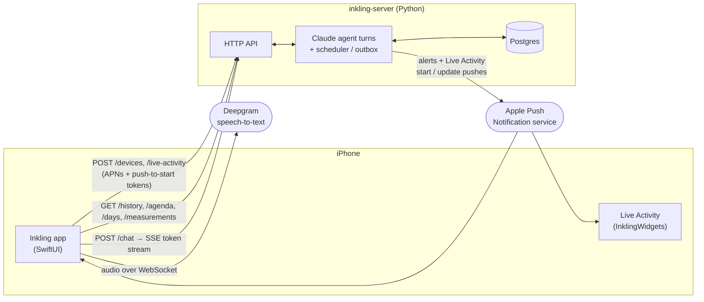

# Inkling for iOS

A native SwiftUI client for **Inkling**, a self-hosted, proactive AI assistant that tracks commitments, deadlines and habits and reaches out on its own, via push notifications and a Live Activity on the lock screen.

<p align="center"></p>

The app is a thin window onto the server: the Python backend ([`inkling-server`](https://github.com/sharduldhande/inkling-server)) owns the conversation, the state, and every scheduling decision. The app streams chat, mirrors read-only panes, and registers itself so the server can push to it.



## Notable engineering

- **Streaming chat over SSE** with `URLSession.bytes(for:)`, parsed line by line and published to the UI on the main actor as tokens arrive, with no buffering of the response.
- **The server is the source of truth.** The local message cache is only a fast first paint. History sync reconciles optimistic bubbles against the server transcript, and syncs that land mid-stream are deferred, not run concurrently.
- **Honest failure states.** `429 busy` means the server already queued the message, so the app polls `/health` and never resends (a resend would trigger a second agent turn). A 90 s stall watchdog and cold-launch demotion of `.streaming` bubbles catch mid-stream drops that URLSession timeouts miss across app suspension. Retry is offered only when the request provably never reached the server.
- **Server-driven Live Activity.** ActivityKit push-to-start and per-activity update tokens are reported to the server, which starts and updates a "now / next" lock-screen card over APNs while the app isn't running. The app also cleans up duplicate activities when a token report was lost.
- **Shared wire contract.** `Shared/NextUpAttributes.swift` is compiled into both the app and the widget extension, and its `ContentState` decodes the server's APNs JSON directly. Timestamps stay as Unix seconds to avoid Foundation's 2001 reference epoch.
- **Native push** with the APNs environment read from the embedded provisioning profile at runtime, so debug and release builds register against the right gateway without configuration.
- **Live voice input**: an `AVAudioEngine` tap is resampled to 16 kHz mono PCM and streamed over a WebSocket to Deepgram, which returns interim and final transcripts as you speak.
- **No third-party dependencies.** SwiftUI, Observation, ActivityKit, WidgetKit, AVFoundation, URLSession and the Keychain only. Credentials live in the Keychain and are never logged.

## Features

- **Chat**: the main surface. You make changes by talking to the assistant, by text, voice or photo, and its proactive nudges appear in the thread.
- **Today**: overdue items plus the next 48 hours of commitments, recurring tasks and calendar events. Tapping a row opens *Mark done* or *Open in chat*.
- **Log**: a read-only 7-day ledger of calories, exercise and weigh-ins, with GitHub-style activity heatmaps.
- **Lock screen**: a time-sensitive "now / next" Live Activity with live countdowns.

## Tech stack

Swift · SwiftUI (iOS 26, Liquid Glass) · Observation (`@Observable`) · Swift Concurrency · ActivityKit + WidgetKit · APNs · AVFoundation · URLSession (SSE, WebSocket) · Keychain Services

Backend (separate repo): Python, Postgres, Claude Agent SDK, APNs.

## Project layout

```
Inkling/            App target
  InklingClient.swift     HTTP + SSE client, typed errors (401 / 429 / transport)
  ChatStore.swift         Send, stream, queued polling, watchdog, history reconciliation
  AgendaStore / LogStore  Read-only panes with on-disk caches
  PushRegistrar.swift     APNs registration and notification tap routing
  LiveActivityRegistrar   Push-to-start / update token reporting, duplicate cleanup
  Deepgram…Service.swift  Streaming speech-to-text
  *View.swift             SwiftUI screens (Root tab shell, Chat, Today, Log, Settings)
InklingWidgets/     Widget extension: the "next up" Live Activity UI
Shared/             ActivityAttributes shared by the app and the extension
inkling-ios-app-spec.md   Build specification (server contract, states, acceptance list)
```

## Building

Requirements: Xcode 26 and the iOS 26 SDK. Push notifications and Live Activity pushes need a physical device and a paid Apple Developer team.

1. Open `Inkling.xcodeproj`.
2. Under *Signing & Capabilities*, choose your own team and bundle identifier for both the `Inkling` and `InklingWidgets` targets.
3. Build and run the `Inkling` scheme.
4. On first launch, Settings opens. Enter your `inkling-server` URL and bearer token. Optionally add a Deepgram API key to enable voice input.

Chat, Today and Log run in the Simulator against any reachable server. APNs delivery needs a real device.
