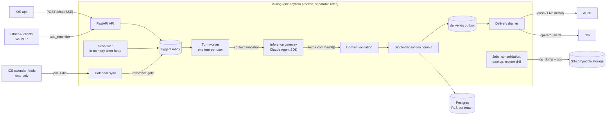

# inkling-server

Backend for **Inkling**, a proactive personal assistant with a native iOS app: a Claude agent that chats, remembers, and reliably reminds, built so the model can never be the reason a reminder is missed.

## Architecture



## Design decisions worth a look

- **Model proposes, code disposes.** The model never touches state. It returns a reply plus a structured `commands[]` array (via a tool call, never parsed from prose), and a domain validation layer (`turns/validate.py`) checks ownership, legal state transitions, and optimistic-concurrency versions. Rejected commands get logged and noted in the reply. They never fail the turn.
- **Deterministic prospective memory.** Commitments, occurrences, and deliveries are tables with explicit state machines. Missed occurrences are caught up on boot and marked `late`, never dropped.
- **Transactional outbox.** Pushes go out only after commit, through a leased drainer with at-least-once semantics, idempotency keys, a 1m/5m/15m/1h backoff, and a dead-letter queue with operator alerts.
- **Fresh session per turn.** Turns never use `--continue`. Context is rebuilt from Postgres each time in a fixed stable-to-volatile order with token budgets (good for prompt caching). The server holds no DB transaction open during the model call.
- **Postgres as the queue.** Triggers are claimed with `FOR UPDATE SKIP LOCKED`, turns hold heartbeat leases, and a reaper requeues them. The design uses no advisory locks, no LISTEN/NOTIFY, and no external broker.
- **DB-quiet scheduler.** Timing lives in an in-process min-heap and the DB is touched only when something changes or fires. This was originally done to stay inside a serverless-Postgres compute budget.
- **Hard tenant isolation.** `FORCE ROW LEVEL SECURITY` is on every table, and the tenant is set with a transaction-local `set_config`. A non-owner runtime role can't run DDL, and `events` is insert-only at the grant level. Cross-tenant isolation tests are mandatory.
- **Resumable streaming.** SSE token streaming writes seq-numbered `turn_events` rows, so a client that reconnects with `Last-Event-ID` gets a replay and then the live stream. The original app's wire contract (429 busy, SSE shapes) is preserved byte for byte.
- **Read-only calendar by construction.** The calendar provider interface has a single `snapshot()` method, and tests assert that no write path exists. Calendar changes are diffed by revision hash and gated by deterministic relevance rules before they can wake the agent.
- **An expendable box.** Deploys go into immutable release directories behind a symlink, with migrate, health check, and automatic rollback. Nightly encrypted `pg_dump` backups carry a checksum, and an automated restore drill verifies them.

## Tech stack

Python 3.12+ · FastAPI + uvicorn · sse-starlette · psycopg 3 (async, pooled) with hand-written SQL · Pydantic v2 · Claude Agent SDK (with metered-API and Codex CLI adapters behind the same gateway protocol) · APNs over HTTP/2 (ES256 JWT) including Live Activities · `icalendar` + `recurring-ical-events` · pytest-asyncio · uv · systemd + Caddy on a Debian VPS · Postgres on Supabase.

## Repo layout

```
inkling/
  api/          FastAPI routes: chat SSE, history, agenda, documents, devices, Live Activity, MCP
  turns/        ingress, worker/lease loop, context assembly, commands, validation, commit
  inference/    gateway protocol + Agent SDK / API / Codex adapters
  scheduler/    timer heap, occurrence materialization
  delivery/     outbox drainer, APNs, Live Activity, ntfy
  calendar_/    ICS fetch, recurrence expansion, snapshot diff, relevance gate
  jobs/         nightly consolidation, backup, restore drill
  db/           async pool + tenant helper, numbered SQL migrations, queries
  prompts/      system prompt
deploy/         systemd unit, deploy script (release dirs + rollback), Caddy snippet
ops/            runbook (rebuild from zero), migration notes, acceptance checklist
tests/          ~380 pytest tests, including cross-tenant isolation and acceptance tests
```

`python -m inkling <role>` runs `api`, `worker`, `scheduler`, `delivery`, `calendar`, `jobs`, or `all` (the default deployment, a single process). It also provides `migrate` and `seed`.

## Running locally

```sh
uv sync
cp .env.example .env            # fill in DB URLs, token files, etc.
uv run python -m inkling migrate
uv run python -m inkling all
```

Tests need a real Postgres (the RLS semantics matter). Each run **drops and recreates the schema**, so the harness refuses any URL whose host or database name lacks a `test` marker:

```sh
export TEST_DATABASE_URL=postgres://...test...
uv run pytest
```
